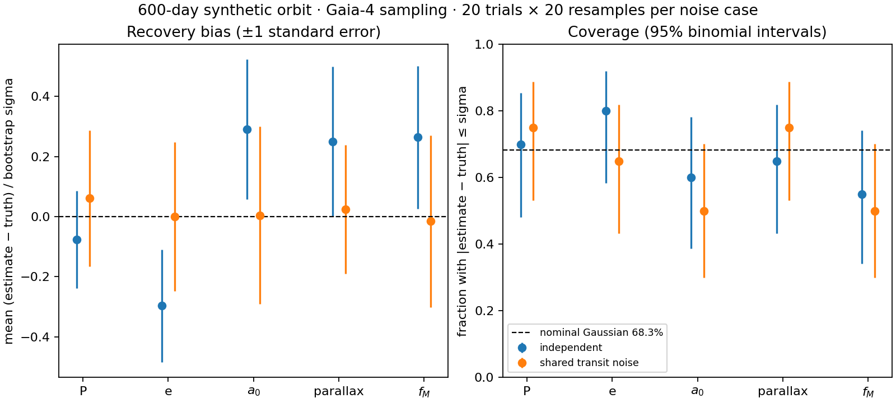

# Transit-bootstrap check

This is a small injection–recovery experiment for Chapter 5, run separately so it adds no work to the student
notebook. It imports the notebook's function definitions, including its optimiser and transit bootstrap.

From the repository root, with `requirements.txt` installed:

```bash
python scripts/check_transit_bootstrap.py
```

The default run uses 20 independent noise realisations and 20 bootstrap resamples per realisation, for each of
two noise cases. Allow several minutes. Outputs in `_build/bootstrap_validation/` are `coverage.png`,
`coverage.pdf`, `recoveries.csv`, `summary.csv` and `run.json`. The last file records seeds, injected parameters,
package versions, and checksums of the input data, script and notebook. A quick execution check is
`python scripts/check_transit_bootstrap.py --trials 2 --bootstrap 10 --out _build/bootstrap_smoke`;
two trials cannot assess coverage.

## Experiment

The sampling, scan angles, parallax and colour factors, and CCD uncertainties come from the public Gaia-4 epoch
data used in Chapter 5. Measured along-scan positions are replaced entirely with a synthetic orbit: period
600 days, eccentricity 0.3, parallax 10 mas, and Thiele–Innes constants
`(A, F, B, G) = (0.80, 0.12, -0.40, 0.60)` mas. This is a deliberately strong orbital signal.
These are chosen inputs, not estimates for Gaia-4.
The injected colour correction is zero, matching the centre of the fitted colour prior.

Each observation gets independent Gaussian noise with its quoted CCD uncertainty. In the second case, all CCDs
in a transit also share one Gaussian offset, with standard deviation equal to the median CCD uncertainty.
Offsets in different transits are independent. The paired cases use the same independent-noise draws.
Neither the fitted weights nor the bootstrap are told the added shared-noise amplitude.

Every fit starts at the injected nonlinear parameters, and every bootstrap starts at that realisation's fitted
parameters. We check period, eccentricity, photocentre semimajor axis, parallax, and astrometric mass function.
The interval is the fitted estimate plus or minus half the bootstrap 16–84 percentile range, exactly the
uncertainty convention used in the notebook. It is not a bootstrap percentile confidence interval.



**Figure V.1.** The generated `coverage.png` compares independent CCD noise (blue) with added shared transit noise
(orange). Left: mean recovery error divided by each realisation's bootstrap uncertainty, with one standard error
on the mean; all quantities are dimensionless. Right: fraction of the 20 fitted intervals containing the injected
value, with 95% Wilson binomial intervals. Dashed lines mark zero bias and nominal Gaussian 68.3% coverage.
The five horizontal positions are period, eccentricity, semimajor axis, parallax and mass function.

## Recorded run

The [saved results](transit_bootstrap/summary.csv), [per-trial recoveries](transit_bootstrap/recoveries.csv),
[PDF figure](transit_bootstrap/coverage.pdf), and [run metadata](transit_bootstrap/run.json) use seed `20261102`,
20 trials and 20 resamples, with 824 observations in 93 transits. The injected semimajor axis is 0.9188 mas;
the added shared offset has standard deviation 0.0819 mas.

| Parameter | Independent noise: coverage | Shared transit noise: coverage |
|---|---:|---:|
| Period | 70% | 75% |
| Eccentricity | 80% | 65% |
| Semimajor axis | 60% | 50% |
| Parallax | 65% | 75% |
| Mass function | 55% | 50% |

Every 95% binomial interval contains the nominal 68.3%, and every mean pull is within two standard errors of
zero. This small experiment therefore finds no decisive discrepancy, but it does **not** establish calibrated
coverage. In particular, the shared-noise semimajor-axis and mass-function intervals cover only 10 of 20 trials;
their 95% coverage intervals span roughly 30–70%, allowing substantial undercoverage. Keep the notebook's
uncertainty caveat. All 800 bootstrap resamples produced finite elements within the checked period and
eccentricity bounds; none were discarded. This is not a certificate of global optimisation.

## Limits

This checks local uncertainty estimates for one well-measured orbit and one sampling pattern. It does not check detection,
period aliases, different orbital geometries, BH3's incomplete long-period arc, outliers, errors correlated across
transits, or a wrong astrometric model. The same forward model generates and fits the data. With only 20 trials,
coverage uncertainty is roughly 20 percentage points at 95% confidence near 68%; 20 bootstrap resamples also
give noisy interval widths. The results are diagnostics, not a pass/fail certification of the notebook's real-star
uncertainties, and no coverage threshold is tuned after seeing the results.

An initial 40-trial, 50-resample run was stopped for runtime during the shared-noise case, before inspecting
coverage. The default workload was reduced to keep this a practical diagnostic; increase `--trials` and
`--bootstrap` for a more precise assessment. The first shared-noise fit with an orbit four times smaller moved
from the injected eccentricity 0.3 to about 0.98 and its resampling was prohibitively slow. The orbit was therefore
strengthened before assessing coverage. This check deliberately excludes that weak-signal regime; it cannot
establish calibration for the real Gaia-4 orbit or justify the notebook's planet-mass probability.

The script first asserts noiseless recovery of the injected parameters to relative tolerance `1e-6`. It stops on
non-finite or unphysical bootstrap elements rather than silently discarding them. The initial run exposed an
eccentricity-boundary bug: the optimiser evaluated a clipped eccentricity but returned an unclipped value.
Chapter 5 now returns the value actually evaluated; regression tests cover both boundaries.
